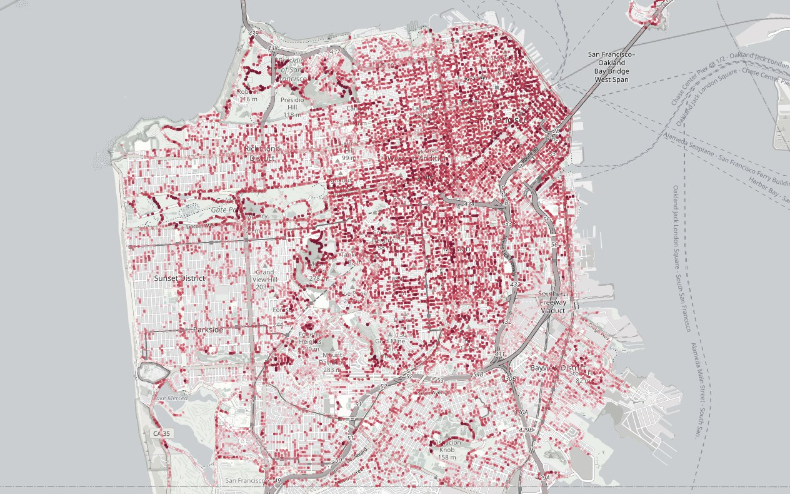

# 天空可视因子

行人究竟能看到多少天空？天空可视因子（Sky View Factor, SVF）直接影响街道层面的热环境和舒适度，但它通常是在街景车行驶的车行道上测量的，而不是在人们步行的人行道上。本项目比较了基于激光雷达和基于图像的 SVF 估算方法，服务于精细尺度的城市微气候分析，把测量位置挪到了行人尺度。

在旧金山 15,630 张街景图像中，人行道上测得的 SVF 平均比街景车所在的车行道低 0.16。把同样的方法用于洛杉矶，人行道 SVF 平均比车行道低 0.093。

**我的工作：** 作为主要贡献者之一，我搭建了整套技术流程，并完成了数据准备、实验和验证。

部分成果于 2026 年 7 月在新加坡国立大学举办的第 33 届国际地理信息科学大会（Geoinformatics 2026）上报告，同场还展示了城市感知、街道形态与气候敏感型规划分析方面的更多工作。

下方的交互演示展示了旧金山全市人行道尺度的 SVF 分布。

<a class="figure-link" href="/portfolio/SVF/" title="打开交互地图"><picture><source type="image/webp" srcset="/assets/responsive/svf-map-preview-4921d9e4b3c8-320.webp 320w, /assets/responsive/svf-map-preview-4921d9e4b3c8-480.webp 480w, /assets/responsive/svf-map-preview-4921d9e4b3c8-640.webp 640w, /assets/responsive/svf-map-preview-4921d9e4b3c8-960.webp 960w, /assets/responsive/svf-map-preview-4921d9e4b3c8-1264.webp 1264w" sizes="(max-width: 800px) calc(100vw - 2.5rem), 760px"></picture></a>

旧金山 15,630 个位置的车行道与人行道 SVF 之差：红色越深，差值越大。点击地图可进入交互页面。底图 &copy; OpenStreetMap contributors。

    <a href="/portfolio/SVF/" class="learn-more-btn">查看演示</a>

