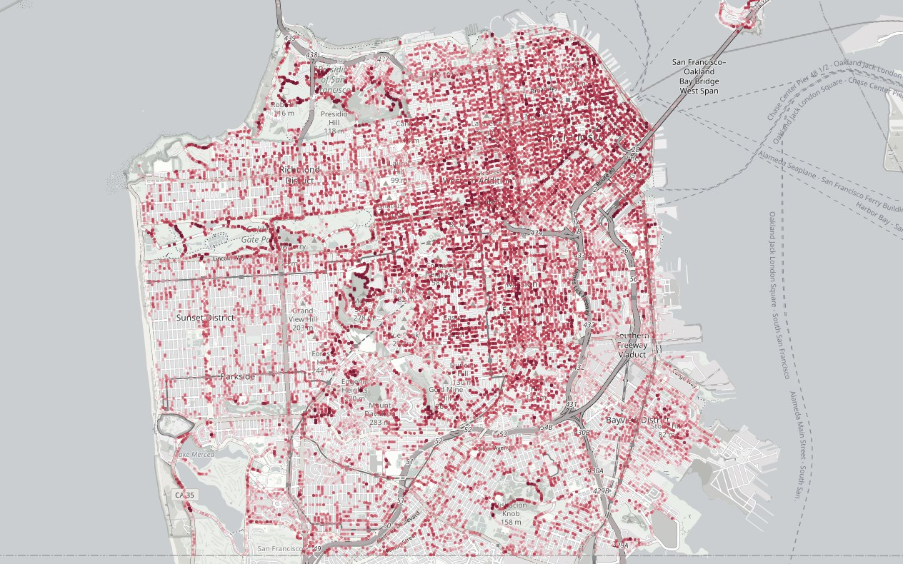

# Sky View Factor

How much sky can a pedestrian actually see? Sky View Factor (SVF) drives street-level heat and comfort, but it is usually measured from the roadway, where street view cars drive, rather than from the sidewalk, where people walk. This project compares LiDAR-based SVF estimation with imagery-based approaches for fine-grained urban microclimate analysis, moving the measurement to pedestrian scale.

Across 15,630 street-level images of San Francisco, SVF measured on the sidewalk averages 0.16 lower than estimates taken at the roadway, where street view cars drive. Applying the same method to Los Angeles, sidewalk SVF averages 0.093 lower than at the roadway.

**My role:** As one of the lead contributors, I built the pipeline and carried out the data preparation, experiments, and validation.

Part of this work was presented at the 33rd International Conference on Geoinformatics (Geoinformatics 2026) at the National University of Singapore in July 2026, alongside broader work on urban sensing, street-level morphology, and climate-sensitive planning analytics.

The interactive demo below maps sidewalk-scale SVF across San Francisco.

<a class="figure-link" href="/portfolio/SVF/" title="Open the interactive map"><picture><source type="image/webp" srcset="/assets/responsive/svf-map-preview-4921d9e4b3c8-320.webp 320w, /assets/responsive/svf-map-preview-4921d9e4b3c8-480.webp 480w, /assets/responsive/svf-map-preview-4921d9e4b3c8-640.webp 640w, /assets/responsive/svf-map-preview-4921d9e4b3c8-960.webp 960w, /assets/responsive/svf-map-preview-4921d9e4b3c8-1264.webp 1264w" sizes="(max-width: 800px) calc(100vw - 2.5rem), 760px"></picture></a>

Roadway minus sidewalk SVF at 15,630 locations in San Francisco: the darker the red, the larger the gap. Select the map to explore it. Basemap &copy; OpenStreetMap contributors.

    <a href="/portfolio/SVF/" class="learn-more-btn">View Demo</a>

